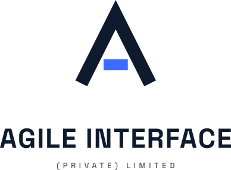

<a href="https://agileinterface.com">
  <picture>
    <source media="(prefers-color-scheme: dark)" srcset="assets/img/logo/agile-interface-stacked-reversed.svg">
    <source media="(prefers-color-scheme: light)" srcset="assets/img/logo/agile-interface-stacked-color.svg">
    
  </picture>
</a>

  

**We build Android, iOS, desktop and web apps, from one Kotlin codebase.**

[Website](https://agileinterface.com) · [Contact](mailto:hello@agileinterface.com) · [Privacy Policy](https://agileinterface.com/privacy) · [Terms of Service](https://agileinterface.com/terms)

---

## About us

**Agile Interface (Private) Limited** is a product-first software house founded by two Kotlin Multiplatform developers and an ASO marketer.

Our mission is simple:

- Build products we would want to use ourselves.
- Write them once in Kotlin. Ship them to every screen.
- Keep improving them long after launch.

## What we do

| Service | What it means |
| --- | --- |
| **Multiplatform apps** | Android, iOS and desktop apps from a shared Kotlin codebase |
| **Web products** | Web apps and sites built with the same shared core |
| **UI/UX design** | Flows and screens you can click through before we write code |
| **Launch and growth** | Store launch, ASO, analytics and updates after release |

## How we build

We use **Kotlin Multiplatform** and **Compose Multiplatform**, so a product is written once and shipped to Android, iOS, desktop and the web, without four separate teams or four separate codebases.

- **Shared core.** Business logic, networking and data are written once in Kotlin.
- **Shared UI.** Screens are built with Compose Multiplatform, shared wherever it makes sense.
- **Native where it counts.** Platform-specific code only where a platform needs it.

## How we work

1. **Discover.** The problem, the users and what success looks like.
2. **Design.** Flows and screens you can click through before we code.
3. **Build.** Shared Kotlin core, polished platform UI, regular test builds.
4. **Ship and grow.** Store launch, analytics and updates after release.

## Our products

All of these are currently in development for Android.

- **Qibla Compass & Quran.** Find the Qibla from anywhere, get accurate prayer times with adhan, follow the Hijri calendar and read the Quran, with recitation practice that highlights each word you read correctly or wrongly.
- **Translator.** The translator that teaches you. Translate text, voice and camera input, then keep what you learn with phrases, favorites and history.
- **AI Phone Doctor.** An AI assistant that checks your phone's health, explains what is wrong in plain language and suggests how to fix it.
- **Charging Animation.** Turn every charge into a show with custom charging animations, plus charging stats and battery health tips.
- **Street View Voice Navigation.** Turn-by-turn voice navigation with live traffic status and street-level views, plus an AI trip planner that builds day-by-day plans you can open on the map.

## Team

| Name | Role |
| --- | --- |
| [Muhammad Hasnain](https://github.com/naine-dev) | Kotlin Multiplatform |
| [Syed Turab Haider](https://www.linkedin.com/in/syed-turaab-haider-kazmi-93440228a) | Kotlin Multiplatform |
| Muhammad Danyal | ASO Expert Marketing |

## Get in touch

Tell us what you're building. We'll reply with questions and a suggested plan.

**[hello@agileinterface.com](mailto:hello@agileinterface.com)** · **[agileinterface.com](https://agileinterface.com)**

---

© Agile Interface (Private) Limited. All rights reserved.

